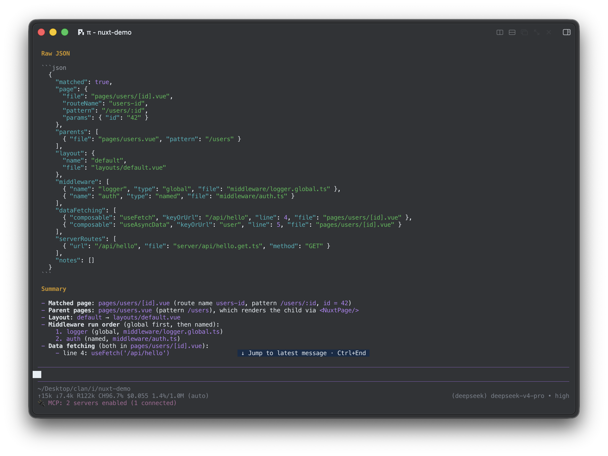

<div align="center">

<h1>mcp-server-nuxt</h1>

<p>Give your AI agent Nuxt's resolved view of a project: routes, layouts, middleware, auto-imports, layers, and Nitro endpoints.<br/>No dev server. No <code>nuxi prepare</code>.</p>

[](https://www.npmjs.com/package/mcp-server-nuxt)
[](https://www.npmjs.com/package/mcp-server-nuxt)
[](https://github.com/rynx-cc/mcp-server-nuxt/actions/workflows/ci.yml)
[](https://nodejs.org)
[](./LICENSE)

</div>

<p align="center">
  
</p>

<p align="center"><sub>An agent asking <code>explain_route</code> what happens when someone opens <code>/users/42</code>.</sub></p>

## Quick start

Add this to `.cursor/mcp.json` (Cursor), `.mcp.json` (Claude Code), or your client's MCP config:

```json
{
  "mcpServers": {
    "nuxt": {
      "command": "npx",
      "args": ["-y", "mcp-server-nuxt@latest", "/absolute/path/to/your/nuxt/app"]
    }
  }
}
```

Restart your client and ask something like:

> What happens when someone opens /users/42?

Requirements: Node.js 18+, macOS or Linux. Write tools stay in dry-run mode until you [enable writes](#write-protection).

## Why

A generic agent sees a Nuxt repo as a folder tree. It doesn't know that:

- `pages/users/[id].vue` serves `/users/:id`, and which layout and middleware `definePageMeta` adds
- `components/base/BaseButton.vue` is usable as `<BaseButton>` with no import
- `composables/useFoo.ts` makes `useFoo()` available everywhere
- `extends: ['../ui-kit']` layers components, pages, and config over your app
- `server/api/hello.get.ts` registers `GET /api/hello`

So it guesses, and invents import paths, misnames components, and misreads layer precedence. `mcp-server-nuxt` reads Nuxt's own config loader and `.nuxt/` output (with a source-level fallback) and hands the agent the real answers through **25 tools** and **7 read-only resources**.

It runs as a standalone CLI, so it works on a freshly cloned repo before anyone has installed dependencies or started `npm run dev`.

## Highlight: `explain_route`

Most tools tell you which routes exist. `explain_route` tells you what actually happens for one real URL.

```jsonc
// input
{ "route": "/users/42" }

// output (abridged)
{
  "matched": true,
  "page": { "file": "pages/users/[id].vue", "pattern": "/users/:id", "params": { "id": "42" } },
  "parents": [{ "file": "pages/users.vue", "pattern": "/users" }],
  "layout": { "name": "default", "file": "layouts/default.vue" },
  "middleware": [
    { "name": "logger", "type": "global", "file": "middleware/logger.global.ts" },
    { "name": "auth", "type": "named", "file": "middleware/auth.ts" }
  ],
  "dataFetching": [
    { "composable": "useFetch", "keyOrUrl": "/api/hello", "line": 4, "file": "pages/users/[id].vue" }
  ],
  "serverRoutes": [{ "url": "/api/hello", "file": "server/api/hello.get.ts", "method": "GET" }]
}
```

Middleware comes back in run order (global first, then named), catch-all params come back as arrays, and an unmatched URL returns suggestions.

## Tools

<details open>
<summary><b>Routing</b></summary>

| Tool | What it does |
| --- | --- |
| `explain_route` | Resolve one URL: page, parents, layout, middleware order, data fetching, `/api` files |
| `list_routes` | All routes: dynamic, optional, catch-all, nested |
| `get_route` | One route by pattern, e.g. `/users/:id` |
| `inspect_route_meta` | `definePageMeta`, layout, middleware, props/emits/slots of a page |
| `add_route` ✏️ | Scaffold a page under `pages/` |

</details>

<details open>
<summary><b>Server (Nitro)</b></summary>

| Tool | What it does |
| --- | --- |
| `list_server_routes` | Endpoints, server middleware, and plugins with method and middleware chain |
| `scaffold_nitro_api` ✏️ | Generate an H3 handler with optional Zod body validation |

</details>

<details open>
<summary><b>Components, composables, auto-imports</b></summary>

| Tool | What it does |
| --- | --- |
| `list_components` | Components from `.nuxt/components.d.ts`, or from `components` / `components.dirs` config |
| `inspect_component` | Props, emits, and slots of one component |
| `generate_component` ✏️ | Generate a typed Vue SFC |
| `list_composables` | User-defined and auto-imported composables |
| `generate_composable` ✏️ | Scaffold a typed `useXxx` composable |
| `get_auto_imports` | Auto-import registry with source paths and signatures |
| `get_type_info` | Generated type info (`.nuxt/types`, schema) |

</details>

<details open>
<summary><b>Project and config</b></summary>

| Tool | What it does |
| --- | --- |
| `get_project_overview` | Nuxt version, layers, directories, and counts |
| `analyze_project` | Health check with dependency warnings and prepare hints |
| `read_config` | Resolved `nuxt.config`, filterable by dot path |
| `update_config` ✏️ | Change a config value, keeping comments, and return a diff |
| `list_modules` | Installed modules with version, source, and options |
| `add_nuxt_module` ✏️ | Add a module to `modules` |
| `inspect_layers` | The full `extends` hierarchy in precedence order |

</details>

<details open>
<summary><b>Quality and search</b></summary>

| Tool | What it does |
| --- | --- |
| `check_type_errors` | Run `tsc --noEmit` against `.nuxt/tsconfig.json` |
| `analyze_bundle_deps` | Flag missing or misplaced dependencies |
| `search_code` | Search the codebase with line numbers and context |
| `get_nuxt_docs` | Offline Nuxt guidance for routing, Nitro, modules, layers |

</details>

✏️ = write tool, dry-run by default. Full mapping: [docs/SPEC_MATRIX.md](./docs/SPEC_MATRIX.md).

## Resources

Large, cacheable context is served as read-only resources so the agent doesn't re-scan files every turn.

| URI | Content |
| --- | --- |
| `nuxt://project/overview` | Nuxt version, layers, directories, counts |
| `nuxt://project/routes` | Route map with files, params, middleware, layouts, children |
| `nuxt://project/config` | Resolved `nuxt.config` |
| `nuxt://project/modules` | Modules with status, source, and options |
| `nuxt://project/layers` | `extends` hierarchy with override order (`project > later extends > earlier extends`) |
| `nuxt://project/auto-imports` | Auto-imported symbols with source paths and signatures |
| `nuxt://project/types` | Raw generated types |

`auto-imports` and `types` need `.nuxt/` to exist (`nuxi prepare` or a build). Everything else falls back to reading source.

## Write protection

`add_route`, `scaffold_nitro_api`, `generate_component`, `generate_composable`, `update_config`, and `add_nuxt_module` all work the same way:

1. They default to `dryRun: true` and return the planned file or diff without touching disk.
2. A real write needs `dryRun: false` **and** a server started with writes enabled.
3. Config edits only touch the affected lines and always return a diff.

```json
{
  "mcpServers": {
    "nuxt": {
      "command": "npx",
      "args": ["-y", "mcp-server-nuxt@latest", "/absolute/path/to/your/nuxt/app"],
      "env": { "MCP_NUXT_ALLOW_WRITES": "1" }
    }
  }
}
```

Or on the command line: `mcp-server-nuxt /absolute/path/to/app --allow-writes`.

## Client setup

The JSON in [Quick start](#quick-start) works for Cursor, Claude Code, Claude Desktop, and Windsurf. Always pass an **absolute** project path, since MCP clients often start servers with an undefined working directory.

<details>
<summary><b>Where the config file lives</b></summary>

| Client | File |
| --- | --- |
| Cursor | `.cursor/mcp.json` in the project, or `~/.cursor/mcp.json` |
| Claude Code | `.mcp.json` in the project, or Claude Code settings |
| Claude Desktop (macOS) | `~/Library/Application Support/Claude/claude_desktop_config.json` (strict JSON, no comments) |
| Windsurf | Cascade → MCP settings |

</details>

<details>
<summary><b>VS Code (GitHub Copilot)</b></summary>

VS Code uses `servers` instead of `mcpServers`. In `.vscode/mcp.json`:

```json
{
  "servers": {
    "nuxt": {
      "command": "npx",
      "args": ["-y", "mcp-server-nuxt@latest", "--project", "/absolute/path/to/your/nuxt/app"]
    }
  }
}
```

</details>

<details>
<summary><b>CLI and other package managers</b></summary>

```bash
npx -y mcp-server-nuxt@latest /absolute/path/to/app
pnpm dlx mcp-server-nuxt@latest /absolute/path/to/app
bunx mcp-server-nuxt@latest /absolute/path/to/app

npm install -g mcp-server-nuxt
mcp-server-nuxt --help
```

The project path can be passed positionally or with `--project`. Omit it to use the current directory. The server speaks MCP over stdio; it is not a web service.

</details>

## FAQ

**How is this different from DevTools-style Nuxt MCP servers?**
Those attach to a running dev server, so the agent sees nothing until `npm run dev` is up. `mcp-server-nuxt` is a standalone CLI that reads the project directly, so it works on a fresh clone, in CI, or anywhere the app isn't running.

**Does it support Windows?**
Not officially yet. It's tested on macOS and Linux.

## Contributing

Pull requests are welcome.

```bash
git clone https://github.com/rynx-cc/mcp-server-nuxt.git
cd mcp-server-nuxt
npm install
npm run typecheck && npm test && npm run build
```

- Use [Conventional Commits](https://www.conventionalcommits.org/) (`feat:`, `fix:`, `chore:`).
- Add tests under `tests/` for new tools and resources.
- Keep `@nuxt/kit` optional; every integration needs a fallback.
- Write tools default to dry-run and go through `WriteGuard`.

## License

[MIT](./LICENSE)
